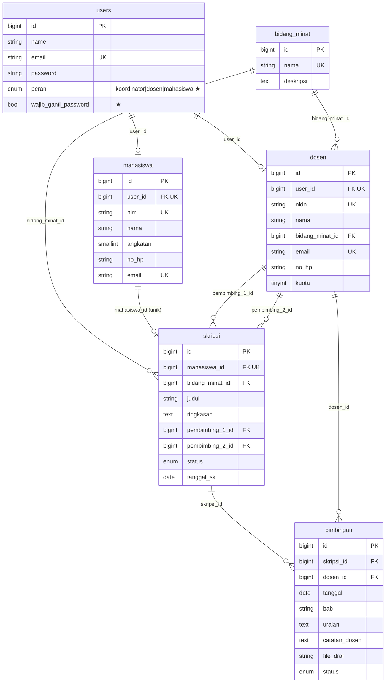

# ERD dan kamus data SIBIS

Enam tabel sesuai Modul 5. Struktur kolom mengikuti Tabel 5.2–5.6 modul; perbedaannya hanya
penambahan **indeks**, **kolom pada `users`**, dan **batasan database** (ditandai ★).

## Penambahan terhadap modul

| Tabel | Penambahan | Alasan |
|---|---|---|
| `users` | `peran`, `wajib_ganti_password`, indeks `peran` | peran akses; memaksa ganti kata sandi awal pada akun impor/reset |
| `skripsi` | ★ CHECK `pembimbing_1_id <> pembimbing_2_id` (PostgreSQL/MySQL) | aturan bisnis #2 dijaga database, bukan hanya form |
| `skripsi` | indeks `status`, `bidang_minat_id`, `(pembimbing_1_id,status)`, `(pembimbing_2_id,status)` | daftar/filter dan hitung kuota dosen |
| `bimbingan` | indeks `(skripsi_id,tanggal)`, `(skripsi_id,status)`, `(dosen_id,status)` | kartu bimbingan, hitung disetujui, antrean dosen |
| `dosen`, `mahasiswa` | indeks `nama`, `bidang_minat_id`/`angkatan` | daftar dan filter |
| semua FK | `restrictOnDelete` (kecuali `bimbingan.skripsi_id` cascade) | data akademik tidak hilang diam-diam |
| PostgreSQL | indeks GIN trigram pada `LOWER(judul/nama/nim)` | pencarian `LIKE '%kata%'` tetap cepat |

## Aturan bisnis dan penegaknya

| # | Aturan | Ditegakkan oleh |
|---|---|---|
| 1 | Satu mahasiswa satu skripsi | pemeriksaan controller + `UNIQUE(skripsi.mahasiswa_id)` |
| 2 | Pembimbing 1 ≠ 2 | Form Request `different` + CHECK database + service |
| 3 | Kuota dosen | `PembimbingService` (transaksi + `lockForUpdate`) |
| 4 | Bimbingan hanya setelah pembimbing ditetapkan, hanya dengan pembimbingnya | `CatatBimbinganRequest` + `SkripsiPolicy` |
| 5 | Bimbingan diperiksa dosen yang bersangkutan | `BimbinganPolicy::periksa` + update bersyarat `status='menunggu'` |
| 6 | Seminar hasil butuh ≥ 8 bimbingan disetujui | `StatusSkripsiService` (dihitung dalam transaksi) |
